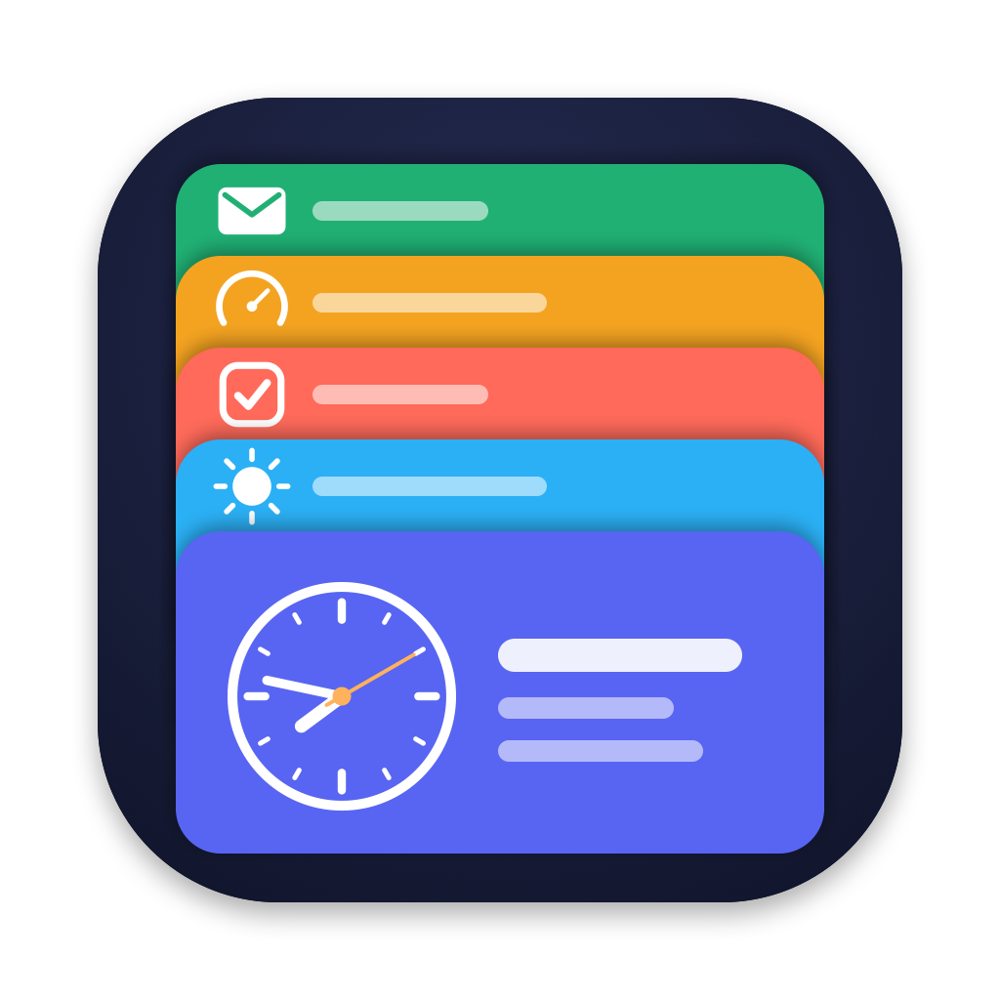
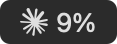
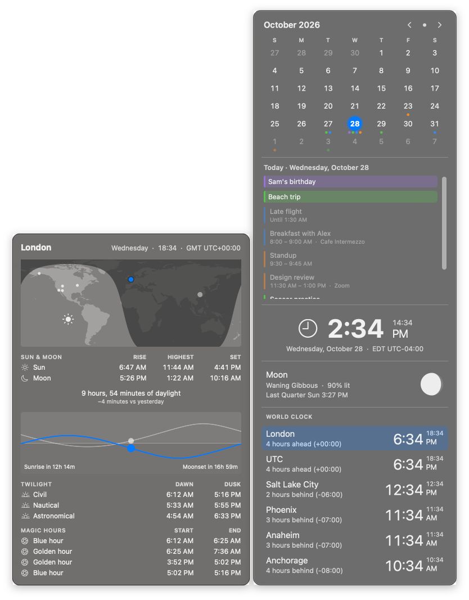
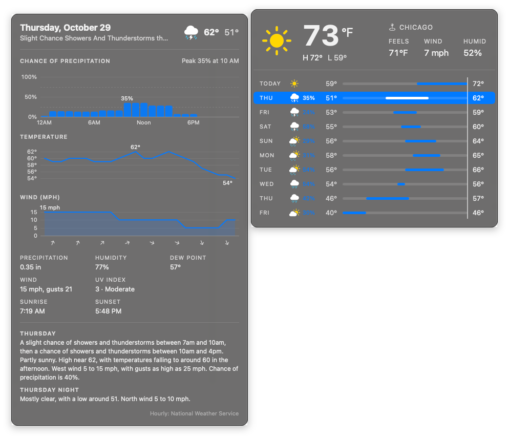
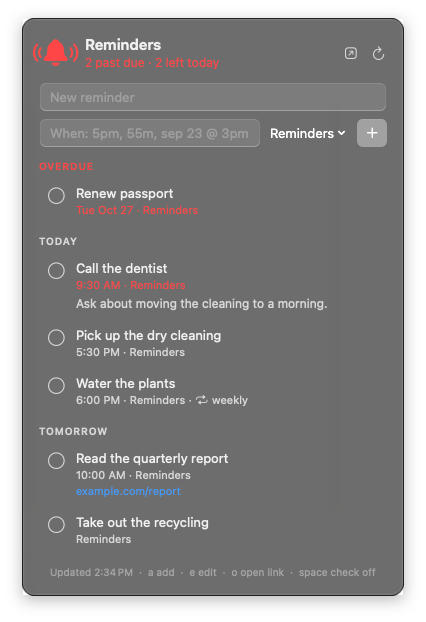
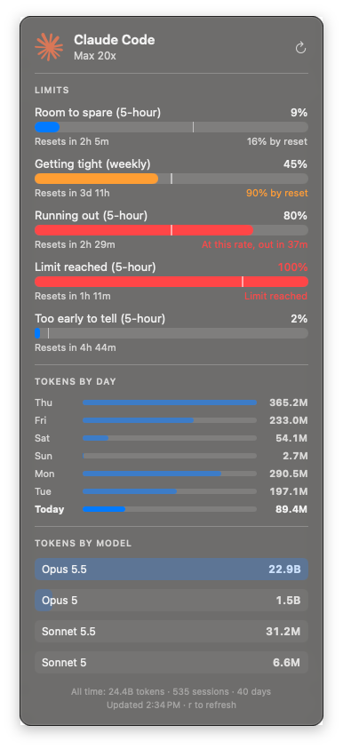
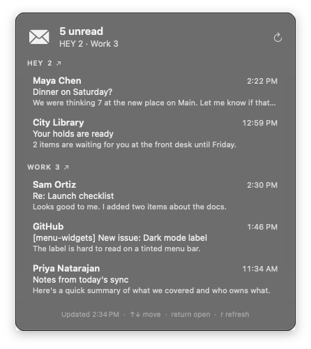

<p align="center">
  
</p>

<h1 align="center">MenuWidgets</h1>

<p align="center">A world clock, a weather forecast, your reminders, new mail and Claude usage meters in the macOS menu bar.</p>

MenuWidgets is a small native Swift app that adds five items to the menu bar.
Any of them can be turned off (see [Configuration](#configuration)).
Click one to open its panel; Esc closes it. In the Time and Weather panels,
hover a row (or use ↑/↓) for a detail pane beside it. As in a macOS menu, the
pane stays put while you move the pointer toward it, even across other rows.
MenuWidgets can also
run commands from global keyboard shortcuts, optionally only in certain apps
(see `hotkeys` under [Configuration](#configuration)).

- **Time** shows the date and time (`Thu Oct 8  7:49 AM`). Its panel opens on
  this month's calendar with today picked. Under each date are dots in the
  colors of the calendars with something that day, up to four (iCloud, and
  any other account in System Settings → Internet Accounts). Click a date for
  its events: all-day ones first, then the rest by start time. Click an event
  to open it in Calendar. The arrows at the top right page a month back or
  forward, and the dot between them returns to today. Below that are the
  local time, the moon phase and your world clocks with their offsets. Hover
  the local time or a zone for a day/night map, sun and moon rise and set,
  day length, twilight and the blue and golden hours (the local time's are
  for where your Mac is); hover the moon for its coming phases. The first
  time the panel opens, macOS asks whether MenuWidgets may use your calendars
  and your location.
- **Weather** shows the current conditions and temperature where your Mac is
  (or for a city you pick; click the place name in the panel to search). Its
  panel has the current feels-like, wind and humidity, and a multi-day
  forecast with the chance of rain per day (its wettest hour, midnight to
  midnight). Hover a day for its hourly rain, temperature and wind, plus that
  day's humidity at the hottest hour from 10 am to 3 pm, the highest dew
  point in those hours, UV and sunrise and sunset. For US locations the
  forecast's first seven days come from the National Weather Service (what
  weather.gov shows); current conditions, the days after that, places
  elsewhere and the fallback come from [Open-Meteo](https://open-meteo.com).
  Keys: ↑/↓, Return to search for a place, `r` refresh.
- **Reminders** shows a bell with how many Apple Reminders are left today
  (red, counting only those, while any are past due; one with a date but no
  time is past due from 9 am, when Reminders alerts for it). Its panel lists
  overdue, today and tomorrow; reminders without a due date aren't shown.
  Add one with a title and a "when" (`5pm`, `55m`, `sep 23 @ 3pm`,
  `tomorrow`), check one off (click again within a couple of seconds to
  undo), or click a row to edit its title, due time, repeat, URL and notes.
  Keys: ↑/↓, space or Return to check off, `a` add, `e` edit, `o` open link,
  `r` refresh, Esc. Alerts are left to Reminders' own notifications. Links to
  files, network shares (`smb:`, `afp:`, `nfs:`, `ftp:`, `vnc:`), `ssh:`,
  `telnet:`, man pages and Help aren't opened, since anyone sharing a list
  with you can set a reminder's URL.
- **Claude** shows your Claude subscription usage: the fullest limit's
  percentage, orange when a limit is getting tight and red when one is at 90%
  or on course to run out before it resets. Its panel has the current limit
  meters with reset countdowns, plus tokens by day and by model from your
  local Claude Code transcripts.
- **Mail** shows an envelope with how many unread conversations wait in your
  [HEY](https://hey.com) Imbox and your Gmail inboxes (Primary only, by
  default), and an orange ! while an inbox needs signing in or can't be read.
  Its panel lists them per inbox, newest first, up to eight each; click one to
  open it in your browser, or hover it to see the sender's address (the name
  alone is whatever the sender typed). Senders and subjects lose bidi
  controls and invisible characters, which can make text read differently
  from what it is, and only HEY's and Google's pages are opened (over https). A new email gets a notification banner (click it to
  open the email), which goes away once you read or archive it elsewhere. Mail
  already waiting at launch gets none, and more than three at once get one
  summary banner. Hover a conversation (or move to it with the arrow keys) and
  click its trash can, or press ⌫, to move the whole conversation to the Trash.
  Gmail's goes at once, and **Undo** puts it back for a few seconds after.
  HEY's CLI can't take a thread back out of the Trash, so a HEY conversation
  asks first (**Trash?**: click or press ⌫ again), and afterwards **Open in
  HEY** opens it there to move it back. A HEY bundle row has no trash can,
  since it stands for a sender's stream rather than one thread. HEY is read
  through the [`hey` CLI](https://github.com/basecamp/hey-cli), whose `watch`
  pushes changes as they happen; Gmail is read through
  [PIM Bridge](https://github.com/ianneub/pim-bridge) every 30 seconds (see
  [Gmail setup](#gmail-setup)). Each check reads at most the newest 100 unread
  Gmail messages and 50 HEY threads, so a bigger backlog shows a lower count.

## Screenshots

The menu-bar labels, in each of their states:

| Widget | Label |
| --- | --- |
| Time |  |
| Weather |      <br>The current conditions, by day or night |
| Reminders |  left today<br> some are past due |
| Claude |  room to spare<br> a limit is getting tight<br> a limit is at 90% or on course to run out |
| Mail |  unread conversations<br> nothing unread<br> an inbox needs signing in or can't be read |

The panels, with made-up reminders, mail and calendar events. Time and
Weather are shown with a row hovered, and its detail pane beside the panel.

### Time



### Weather



### Reminders



### Claude



### Mail



## Requirements

- macOS 15 or later
- Swift 6 (the Xcode Command Line Tools are enough: `xcode-select --install`)
- For the Claude widget: [Claude Code](https://claude.com/claude-code), signed in
  with a Claude subscription. MenuWidgets reads Claude Code's saved sign-in from
  `~/.claude/.credentials.json` if that file exists, and otherwise from the
  Keychain item `Claude Code-credentials`. It never refreshes or changes it.
  It honors `CLAUDE_CONFIG_DIR`, but the app runs under launchd, which doesn't
  see variables set in your shell.

## Install

```sh
git clone https://github.com/ianneub/mac-menu-widgets.git
cd mac-menu-widgets
scripts/install.sh
```

This builds the app, copies it to `~/Applications/MenuWidgets.app` and starts
it with a LaunchAgent (`com.ianneub.menu-widgets`), so it comes back at login.
The log is at `~/Library/Logs/MenuWidgets.log`. There's no Quit item, and a
force quit relaunches it. To stop it until the next login, run
`launchctl bootout "gui/$(id -u)/com.ianneub.menu-widgets"`; to restart it,
`launchctl kickstart -k "gui/$(id -u)/com.ianneub.menu-widgets"`.

The app is ad-hoc signed. If macOS asks, allow it to access your reminders
(for the Reminders widget), your calendars (for the Time widget's month
calendar), your location (for the weather and the Time panel's sun and moon
times) and notifications (for new mail banners). Keychain items are read
through `/usr/bin/security`, so they don't prompt.
macOS ties the Reminders and Calendars permissions to the app's signature, so an ad-hoc build
asks again after each rebuild. To keep it, sign with a stable identity (a
self-signed code-signing certificate from Keychain Access works): put its name
in `~/.config/menu-widgets/sign-identity` or `MENU_WIDGETS_SIGN_IDENTITY`.
The app is signed with the hardened runtime and only the entitlements it uses
(`Assets/MenuWidgets.entitlements`: calendars, which covers reminders,
location, and Apple Events for hotkey commands that script other apps). PIM
Bridge requires that, and answers only the identity it was set up to expect.

The Reminders widget reads the URL field through ReminderKit, the private
framework under EventKit, since EventKit doesn't expose it. If a macOS update
changes that, only the URL field stops working.

To hide the system clock's time now that the Time widget shows it, set
**System Settings → Control Center → Clock Options → Style** to **Analog**.

### Uninstall

MenuWidgets keeps no Gmail sign-ins of its own (PIM Bridge holds them). Then:

```sh
launchctl bootout "gui/$(id -u)/com.ianneub.menu-widgets"
rm -rf ~/Applications/MenuWidgets.app ~/Library/LaunchAgents/com.ianneub.menu-widgets.plist
```

This leaves the settings (`~/.config/menu-widgets`), the cache
(`~/Library/Caches/com.ianneub.menu-widgets`), the log and the Mac's last
known location (`defaults delete com.ianneub.menu-widgets`).

## Configuration

Settings live in `~/.config/menu-widgets/config.json` and are reloaded when the
file changes. Every key is optional; anything missing or of the wrong type uses
the default. A file that isn't valid JSON is ignored until it's fixed, so the
app keeps its current settings (or, at launch, the defaults). The defaults are:

```json
{
  "time": {
    "enabled": true,
    "timeFormat": "12h",
    "showDate": true,
    "calendar": true,
    "hiddenCalendars": [],
    "useLocation": true,
    "zones": [
      { "name": "London", "tz": "Europe/London" },
      { "name": "UTC", "tz": "UTC" },
      { "name": "Denver", "tz": "America/Denver" },
      { "name": "Phoenix", "tz": "America/Phoenix" },
      { "name": "Los Angeles", "tz": "America/Los_Angeles" },
      { "name": "Anchorage", "tz": "America/Anchorage" }
    ]
  },
  "weather": {
    "enabled": true,
    "useLocation": true,
    "name": "Atlanta GA",
    "latitude": 33.749,
    "longitude": -84.388,
    "forecastDays": 10,
    "showTodayRange": true,
    "unit": "F"
  },
  "reminders": { "enabled": true },
  "agents": { "enabled": true, "refreshIntervalSec": 900 },
  "mail": {
    "enabled": true,
    "hey": true,
    "heyCommand": "hey",
    "gmail": false,
    "primaryOnly": true,
    "pollIntervalSec": 30,
    "notify": true,
    "sound": "default"
  },
  "hotkeys": []
}
```

- `enabled`: every widget has it. Set it to `false` to take that widget out of
  the menu bar: it does no work and asks for nothing (no Reminders permission,
  no Keychain read for Claude, no `hey` process). The change applies as soon as
  the file is saved.
- `timeFormat`: `"12h"` or `"24h"`.
- `showDate`: `false` leaves only the time in the menu bar (`7:49 AM`).
- `time.calendar`: the month calendar and the day's events at the top of the
  time panel. `false` hides them, and MenuWidgets never asks for calendar access.
- `time.hiddenCalendars`: calendars to leave out of the dots and the event list,
  by name, ignoring case (`["Birthdays", "US Holidays"]`).
- `time.useLocation`: the local time's map and sun and moon times follow the
  Mac's location, like `weather.useLocation` (the two share one Location
  Services permission, asked for by whichever widget needs it first). While
  it's off, denied or not yet known, they're for the weather's `name`,
  `latitude` and `longitude`.
- `zones`: an IANA time zone string (`"Asia/Tokyo"`) or an object with a
  `tz` and optional `name` and `lat`/`lon`; if any object has no `tz`, the
  default zones are used. The map and sun times use the zone's main city from
  the system's time zone table;
  `lat`/`lon` override it, and a zone with no city there (`UTC`) needs them.
- `forecastDays`: forecast rows, today included (1–14).
- `showTodayRange`: today's high and low under the current temperature.
- `unit`: `"F"` or `"C"`.
- `weather.useLocation`: follow the Mac's location (Location Services, city-level
  accuracy, named by Apple's reverse geocoding). The first time, macOS asks
  whether MenuWidgets may use your location. While it's off, denied or not yet
  known, the forecast is for `name`, `latitude` and `longitude`. Picking a city
  in the panel's location search turns it off and saves the city there;
  picking **Current Location** turns it back on. Either one rewrites
  `config.json` from the settings in use, with every setting filled in and the
  keys sorted (a symlinked or broken file is replaced).
- `mail.gmail`: `true` shows every Gmail account signed in to PIM Bridge, in
  the bridge's order and under the names it gives them. See
  [Gmail setup](#gmail-setup). (Older configs listed the accounts here; a list
  with any accounts in it counts as `true`.)
- `mail.heyCommand`: the `hey` CLI, by name or full path. (The app is started
  by launchd with a short PATH, so it also looks in `~/.local/share/mise/shims`,
  `~/.local/bin`, `/opt/homebrew/bin` and `/usr/local/bin`.) Set `mail.hey` to
  `false` if you don't use HEY.
- `mail.primaryOnly`: count only Gmail's Primary category; `false` counts the
  whole inbox.
- `mail.pollIntervalSec`: seconds between Gmail checks (at least 10). HEY
  relies on `hey watch` pushing changes, with a check every 5 minutes in case
  it misses one. Gmail is also checked when the panel opens, and both are
  checked after the Mac wakes.
- `mail.notify`: `false` turns off the new-mail banners, and MenuWidgets
  never asks for notification permission.
- `mail.sound`: the new-mail banner's sound: `"default"`, `"none"`, or a sound
  by name from `~/Library/Sounds`, `/Library/Sounds` or `/System/Library/Sounds`
  (`"Bottle"`, `"Tink"`, `"Pop"`). To hear it, start the app once with
  `MENU_WIDGETS_MAIL_TEST=1`, which posts a sample banner after a few seconds.
- `agents.refreshIntervalSec`: seconds between full Claude refreshes (a
  transcript scan and a limits check; at least 30). Opening the panel also
  checks the limits, and `r` in the panel refreshes everything.
- `hotkeys`: global keyboard shortcuts that run a command; there's no menu-bar
  item for them. Each is `{"key": "cmd+shift+e", "command": ["/path/to/script",
  "arg"], "apps": ["com.mitchellh.ghostty"]}`. `key` takes `cmd`, `shift`,
  `alt`/`opt` and `ctrl` plus one key (a letter, digit, punctuation, `f1`–`f20`,
  `left`, `right`, `up`, `down`, `space`, `return`, `tab`, `escape`, `backspace`
  (the ⌫ delete key), `delete` (forward delete, fn+⌫), `home`, `end`, `pageup`,
  `pagedown`); every key needs a modifier except the function keys. Letters,
  digits and punctuation name the key in that spot on a US keyboard, whatever
  your layout types there. `command` runs without a shell, from your home
  folder, with output discarded; a bare name is looked up on launchd's short
  PATH, so give scripts a full path. `apps` limits the shortcut to those apps
  (by bundle id: `osascript -e 'id of app "Ghostty"'`) and leaves the key alone
  everywhere else; leave it out for everywhere. No permission is needed. macOS
  refuses shortcuts made only of Option or Option+Shift, which is logged. A
  shortcut another app or macOS already uses usually registers without an error
  but may never run the command, so pick a free one.

### Gmail setup

MenuWidgets reads Gmail through [PIM Bridge](https://github.com/ianneub/pim-bridge),
which owns the Google sign-in and tokens for every app that uses it. Set it up
and add your accounts there (its README has the steps), then set
`mail.gmail` to `true`. MenuWidgets talks to it over the bridge's local socket,
`~/Library/Application Support/PIMBridge/bridge.sock`, asking for each signed-in
account's unread inbox (`is:unread in:inbox`, plus `category:primary` with
`mail.primaryOnly`), and for moving a conversation to the Trash or back.

The bridge checks the signature of every app on the socket and answers only
MenuWidgets signed with the identity it expects and the hardened runtime. If
the panel says PIM Bridge refused MenuWidgets, `~/Library/Logs/PIMBridge.log`
says why. If it says PIM Bridge isn't running, start the bridge.

MenuWidgets checks the other end the same way: whatever answers at the socket
must be PIM Bridge (`com.ianneub.pim-bridge`) signed with MenuWidgets' own Team
ID (or certificate, for a self-signed identity), under the hardened runtime
and closed to debuggers. Anything else gets no requests, and the panel names
it. An ad-hoc-signed MenuWidgets has no signer to compare with, so it doesn't
connect at all; the bridge would refuse it anyway.

When an account's sign-in runs out (a Google app in testing expires sign-ins
after 7 days), its section says so: click **Sign in…** and finish in the
browser. **⋯ → Sign out** signs the account out of PIM Bridge, for every app
that uses it. New accounts are added in PIM Bridge, not here.

## Development

```sh
scripts/test.sh                              # run the unit tests
scripts/build-app.sh                         # build build/MenuWidgets.app
swift scripts/make-icon.swift Assets/AppIcon.png   # redraw the app icon
```

`WidgetsCore` holds the pure logic (time zones, astronomy, weather and usage
parsing, the reminders agenda, repeat rules and "when" parsing, mail diffing and the Gmail/HEY and PIM Bridge parsing) and its tests; `MenuWidgets` is the AppKit/SwiftUI app.

## License

[MIT](LICENSE)
